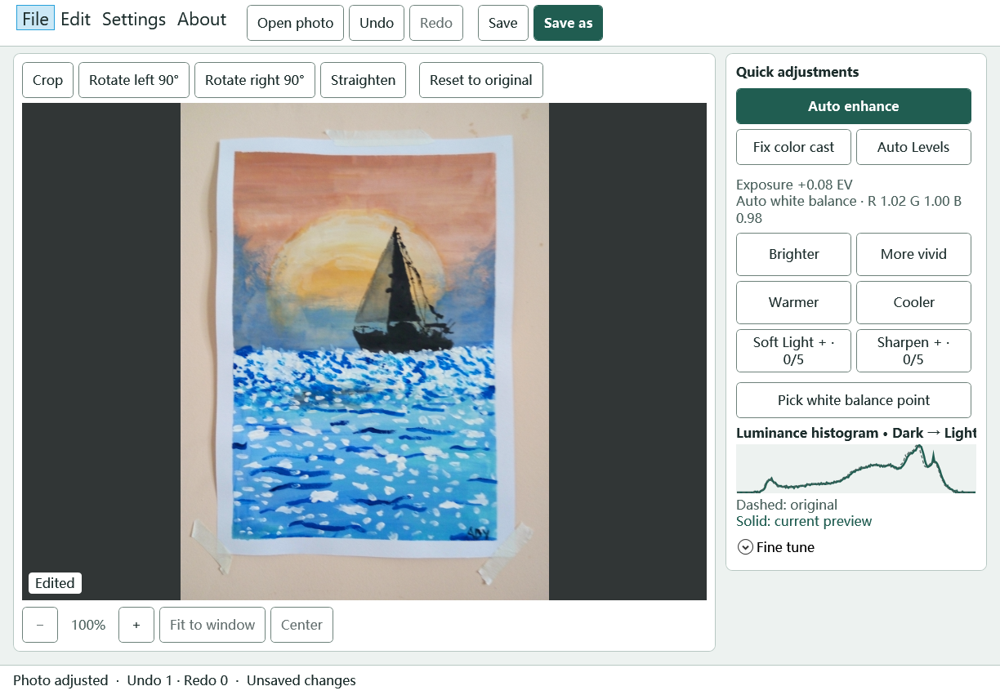

# Photo Color Editor · 0.7 Beta

English · [简体中文](README.zh-CN.md)

Photo Color Editor is an offline Windows photo editor from **SyncPort.ai**, designed with older adults in mind. Large text, high-contrast controls, and clearly labeled one-click adjustments make it easy to start with a photo and see what changed.

[Download 0.7 Beta for Windows 11 x64](https://github.com/vfyang/PhotoColorEditor/releases/tag/v0.7.0-beta)



*Actual editor screenshot with sample-2.jpg open and Auto Enhance applied.*

## Getting started

1. On Windows 11 x64, launch `PhotoColorEditor.exe`. Open a JPG, JPEG, or PNG, drop one onto the window, or choose **File → Sample photos**. You can also download the [warm](samples/warm-mountain.png) and [cool](samples/cool-mountain.png) samples.
2. Start with **Auto enhance** or **Fix color cast**. If you know an area should be white or gray, choose **Pick white balance point** and select a patch with visible detail.
3. Refine the result with the quick adjustments or **Fine tune**. **Reset to original** brings back the full photo so you can start again. Undo and redo support up to 21 steps per window.
4. Choose **Save as** to keep a separate copy. The suggested filename skips existing copies. **Save** asks before replacing the current file.

## Editing tools

- **Color and tone.** View the live luminance histogram, see the applied exposure and white balance, or use Auto Levels, RGB curves, shadows, and highlights.
- **One-click adjustments.** Repeat an adjustment to increase it step by step. Soft Light and Sharpen each have five levels and can be used together.
- **Crop and straighten.** Move or resize the crop box, rotate 90°, or straighten in ±0.5° steps. Type an angle from −15° to +15° for 0.01° precision. Straightening zooms in to fill the corners.
- **Photo preview.** Zoom, fit, center, or drag a zoomed photo to pan. Hold Ctrl while scrolling to zoom.
- **Appearance.** Enable **Settings → Large text**, or choose a light or dark theme. The app follows the Windows display language by default and supports English, Simplified Chinese, and Traditional Chinese.

On first launch, the app registers its per-user Windows **Open with** command. In File Explorer, right-click a photo and choose **Show more options** to find it. **Settings → Add to Windows Open with** refreshes the registration for the app's current path and language.

## Build and test

Use the .NET 10 SDK and PowerShell 7 on Windows.

```powershell
dotnet publish src/PhotoColorEditor -c Release -r win-x64 --self-contained true -p:PublishProfile=Windows-x64 -o dist
dotnet run --project tests/PhotoColorEditor.Tests -- --ui
& tests/Test-SingleFile.ps1 -Exe dist/PhotoColorEditor.exe
```

The tests generate their own photo fixtures. The publish command creates a self-contained `dist/PhotoColorEditor.exe`.

## Project

- [0.7 Beta release notes](CHANGELOG.md)
- [Sample images](samples/README.md)
- [MIT license](LICENSE)
- SyncPort.ai · [contact@syncport.ai](mailto:contact@syncport.ai)
