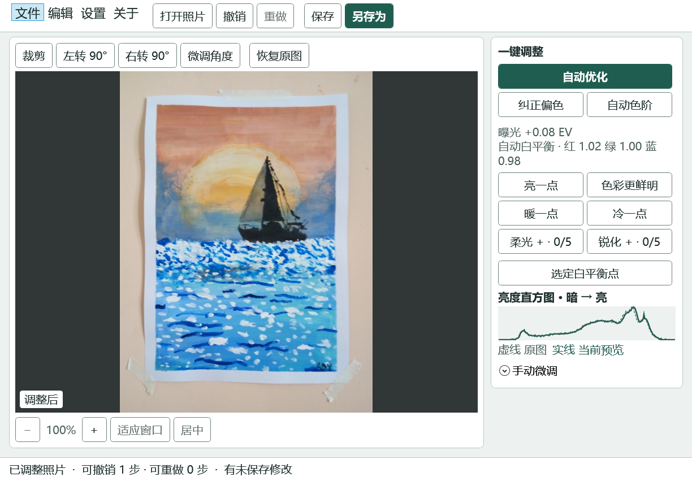

# 照片颜色纠正器 · 0.7 Beta

[English](README.md) · 简体中文 · [繁體中文](README.zh-Hant.md)

**适用于使用 x64 处理器的 64 位 Windows 电脑。** 此测试版已在 Windows 11 上验证。Windows 10 用户也可尝试，软件在该系统上的兼容性有待验证。[微软兼容性说明](https://learn.microsoft.com/zh-cn/dotnet/core/install/windows#supported-versions)

如需确认电脑的系统版本和处理器，请打开「开始 → 设置 → 系统 → 关于」，查看「Windows 规格」，并确认「系统类型」显示「基于 x64 的处理器」。[微软帮助](https://support.microsoft.com/zh-cn/windows/experience/find-information-about-your-windows-device)

## 下载并打开软件

1. **[下载 Windows 版照片颜色纠正器（ZIP）](https://github.com/vfyang/PhotoColorEditor/releases/download/v0.7.0-beta/PhotoColorEditor-0.7.0-beta-win-x64.zip)**。
2. 打开「文件资源管理器 → 下载」。右键单击刚下载的 ZIP 文件，选择「全部提取」，再点「提取」。[微软解压帮助](https://support.microsoft.com/zh-cn/windows/experience/storage-filemanagement/zip-and-unzip-files)
3. 打开解压后出现的新文件夹，双击 **PhotoColorEditor.exe**。文件名也可能显示为 **PhotoColorEditor**。

下载包已包含运行所需的文件。以后从同一个文件夹双击打开即可。下载后可以离线编辑照片。

**想把字调大？** 在软件中点「设置 → 大字体」。界面为长辈设计，按钮文字清晰，常用调整一键就能完成。

*实际软件截图。已打开 sample-2.jpg，并启用大字号和自动优化。*

[查看示例照片的原图和编辑后对照](samples/README.md)

## 编辑第一张照片

1. 点「打开照片」，选一张 JPG、JPEG 或 PNG 照片。想先练习，可以点「文件 → 示例照片」。
2. 点「自动优化」或「纠正偏色」。如果你知道画面里哪一块本来是白色或灰色，点「选定白平衡点」，再点那块仍能看见细节的区域。
3. 用「亮一点」「暖一点」等按钮继续调整，或者展开「手动微调」。想从头试一次时，点「恢复原图」。每个窗口支持最多 21 步撤销和重做。
4. 点「另存为」保留一份调整后的照片。建议的文件名会跳过已有文件。点「保存」时，软件会先确认是否覆盖当前文件。

## 更多编辑工具

- **明暗和颜色。** 用「自动色阶」改善照片的明暗层次，或在「手动微调」里调整阴影、高光和颜色。亮度直方图用虚线显示原图，用实线显示当前预览。
- **一键调整。** 每点一次增加一步。「柔光」和「锐化」各有 5 档，可以一起使用。
- **裁剪和旋转。** 拖动裁剪框的边或角调整大小，拖动框内移动位置。可以旋转 90°，也可以用「微调角度」每次转 0.5°。输入小数可精确到 0.01°。微调角度时，画面会放大以填满边角。
- **查看照片。** 可以放大、缩小、适应窗口或居中。放大后拖动照片，可以查看其他位置。
- **语言和主题。** 在「设置」中切换简体中文、繁體中文或 English，也可选浅色或深色主题。软件默认跟随 Windows 显示语言。

在 Windows 文件资源管理器中，也可以右键单击照片，选择「用照片颜色纠正器打开」。Windows 11 用户可先点「显示更多选项」。移动软件后，可在软件内点「设置 → 加入 Windows 打开方式」更新这项菜单。

## 帮助与信息

- [0.7 Beta 发布说明](https://github.com/vfyang/PhotoColorEditor/releases/tag/v0.7.0-beta)
- [MIT 许可证](LICENSE)
- SyncPort.ai · [contact@syncport.ai](mailto:contact@syncport.ai)
