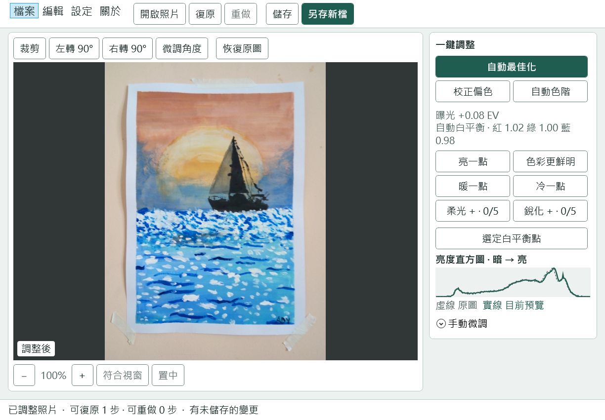

# 照片顏色校正器 · 0.7 Beta

[English](README.md) · [简体中文](README.zh-CN.md) · 繁體中文

**適用於使用 x64 處理器的 64 位元 Windows 電腦。** 此測試版已在 Windows 11 上驗證。Windows 10 使用者也可試用，軟體在該系統上的相容性有待驗證。[Microsoft 相容性說明](https://learn.microsoft.com/zh-tw/dotnet/core/install/windows#supported-versions)

如需確認電腦的系統版本和處理器，請開啟「開始 → 設定 → 系統 → 關於」，查看「Windows 規格」，並確認「系統類型」顯示「x64 型處理器」。[Microsoft 說明](https://support.microsoft.com/zh-tw/windows/experience/find-information-about-your-windows-device)

## 下載並開啟軟體

1. **[下載 Windows 版照片顏色校正器（ZIP）](https://github.com/vfyang/PhotoColorEditor/releases/download/v0.7.0-beta/PhotoColorEditor-0.7.0-beta-win-x64.zip)**。
2. 開啟「檔案總管 → 下載」。以滑鼠右鍵按一下下載的 ZIP 檔案，選擇「全部解壓」，再按「解壓縮」。[Microsoft 解壓縮說明](https://support.microsoft.com/zh-tw/windows/experience/storage-filemanagement/zip-and-unzip-files)
3. 開啟解壓後出現的新資料夾，按兩下 **PhotoColorEditor.exe**。檔名也可能顯示為 **PhotoColorEditor**。

壓縮檔已包含執行所需的檔案。下次使用時，從同一個資料夾按兩下開啟即可。下載後可離線編輯照片。

**想把字調大？** 在軟體中選擇「設定 → 大字體」。介面為長輩設計，按鈕文字清楚，常用調整一鍵就能完成。

*實際軟體畫面。已開啟 sample-2.jpg，並啟用大字體和自動最佳化。*

[檢視範例照片的原圖和編輯後對照](samples/README.md)

## 編輯第一張照片

1. 按「開啟照片」，選擇 JPG、JPEG 或 PNG 照片。想先練習，可以選擇「檔案 → 範例照片」。
2. 按「自動最佳化」或「校正偏色」。如果知道畫面中哪一塊原本是白色或灰色，按「選定白平衡點」，再點選該區域中仍看得見細節的位置。
3. 用「亮一點」「暖一點」等按鈕繼續調整，或展開「手動微調」。想重新開始時，按「恢復原圖」。每個視窗最多可復原及重做 21 步。
4. 按「另存新檔」保留一份調整後的照片。建議檔名會跳過既有檔案。按「儲存」時，軟體會先確認是否覆寫目前的檔案。

## 更多編輯工具

- **明暗和色彩。** 用「自動色階」改善照片的明暗層次，或在「手動微調」中調整陰影、高光和色彩。亮度直方圖以虛線顯示原圖，以實線顯示目前的預覽。
- **一鍵調整。** 每按一次增加一步。「柔光」和「銳化」各有 5 檔，可同時使用。
- **裁剪和旋轉。** 拖曳裁剪框的邊或角可調整大小，拖曳框內可移動位置。可旋轉 90°，也可用「微調角度」每次轉 0.5°。輸入小數可精確到 0.01°。微調角度時，畫面會放大以填滿邊角。
- **檢視照片。** 可放大、縮小、符合視窗或置中。放大後拖曳照片，即可檢視其他位置。
- **語言和主題。** 在「設定」中切換簡體中文、繁體中文或 English，也可選擇淺色或深色主題。軟體預設跟隨 Windows 顯示語言。

在 Windows 檔案總管中，也可以用滑鼠右鍵按一下照片，選擇「使用照片顏色校正器開啟」。Windows 11 使用者可先按「顯示更多選項」。移動軟體後，可在軟體中選擇「設定 → 加入 Windows 開啟方式」更新這個選單項目。

## 說明與資訊

- [0.7 Beta 版本說明](https://github.com/vfyang/PhotoColorEditor/releases/tag/v0.7.0-beta)
- [MIT 授權](LICENSE)
- SyncPort.ai · [contact@syncport.ai](mailto:contact@syncport.ai)
