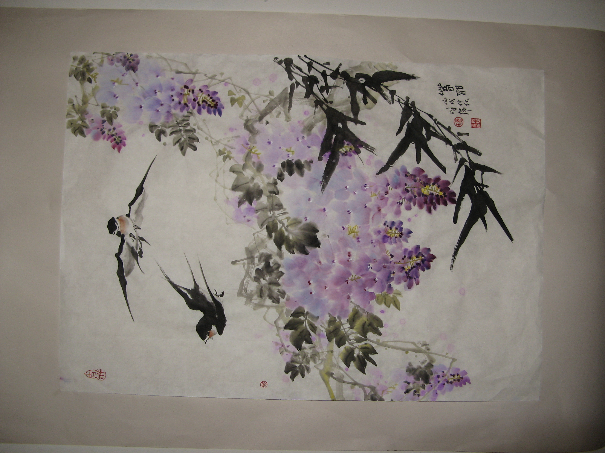
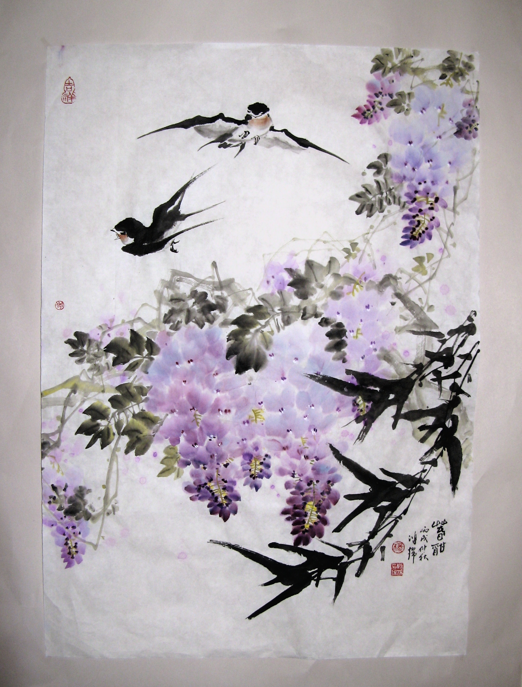
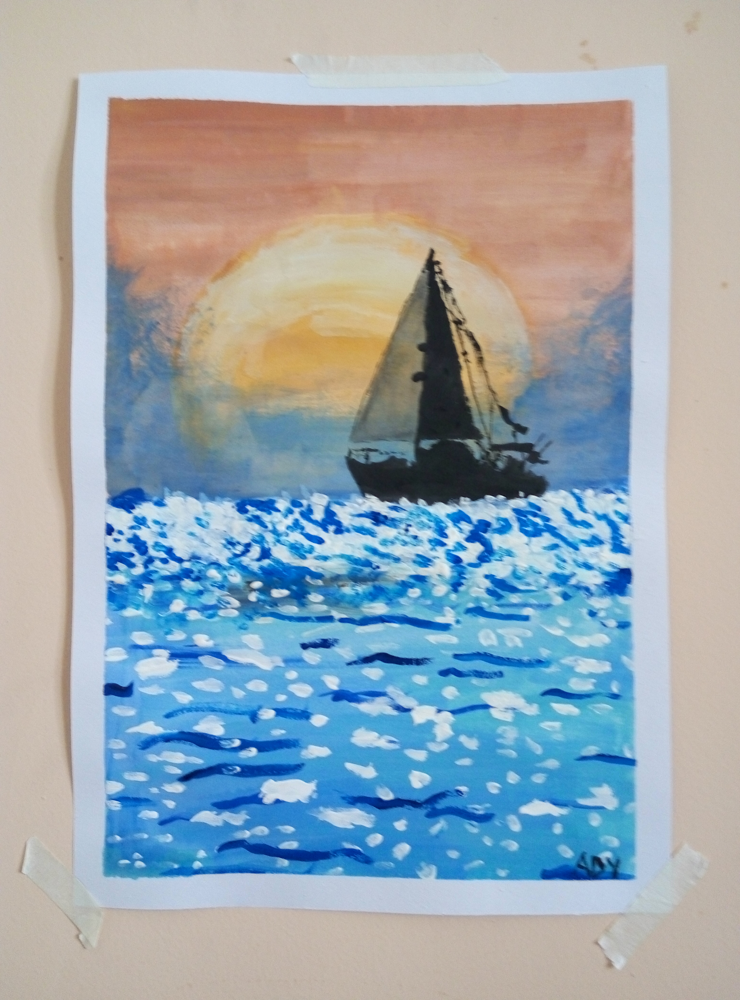
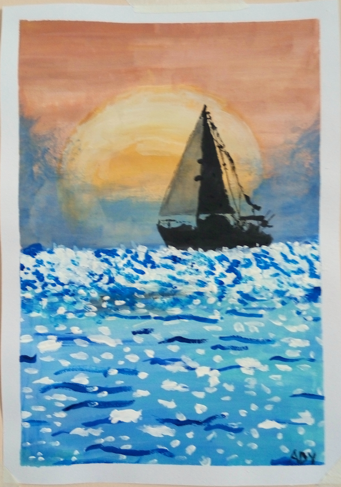

# Sample images

## Before and after · 编辑前后 · 編輯前後

Select either image to open the full-size JPEG. 点击图片可查看原尺寸。點選圖片可查看原尺寸。

### Swallows and wisteria · 紫藤飞燕 · 紫藤飛燕

| Original · 原图 · 原圖 | Edited · 编辑后 · 編輯後 |
| --- | --- |
|  |  |

### Sailboat at sunset · 日落帆船

| Original · 原图 · 原圖 | Edited · 编辑后 · 編輯後 |
| --- | --- |
|  |  |

## Practice with the built-in images

These two PNGs show the same generated scene with different color casts. Use the pale patch on the cabin wall to try the white-balance picker, or use either image to test drag-and-drop, rotation, cropping, and Save As.

- [Warm mountain](warm-mountain.png)
- [Cool mountain](cool-mountain.png)

Both images are 960 × 660 pixels. They come from the [built-in sample generator](../src/PhotoColorEditor/SamplePhoto.cs) and are available under the repository’s [MIT license](../LICENSE).
